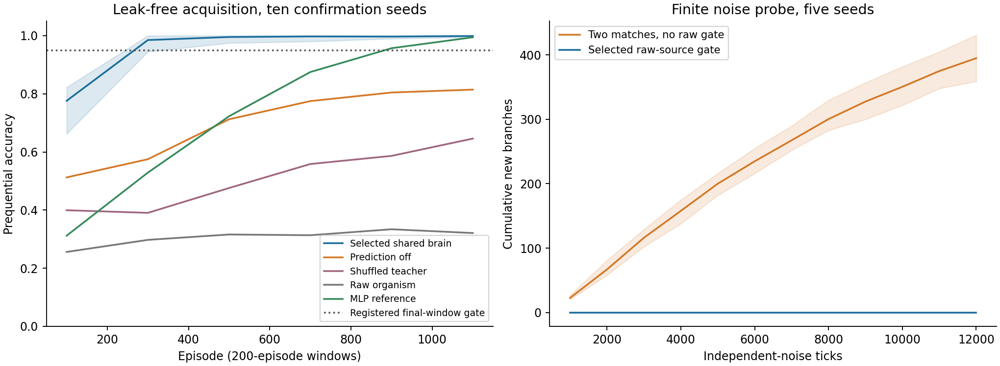
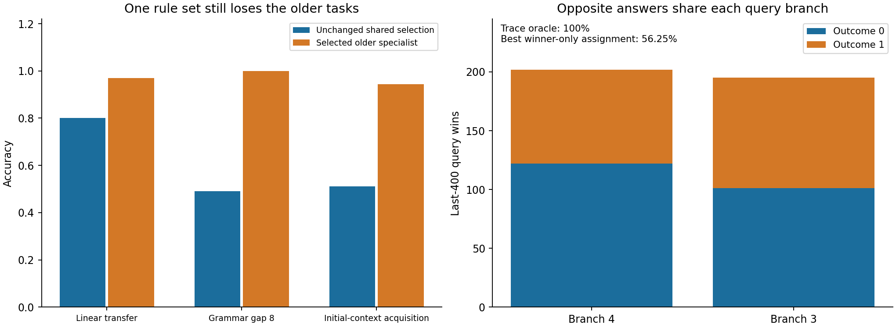

# SOMA current research state — 2026-10-11

**Pass 4 establishes reliable finite nonlinear acquisition by local prediction
plus recruited conjunctive branches. It does not establish nonlinear
composition or a reliable unified brain.** On a leak-free raw-factor task,
all ten confirmation seeds pass: final-window mean 99.80%,
frozen mean 99.95%. Independent-noise recruitment
falls from 395 to zero births per 12000 ticks across five seeds.

The same configuration still loses the older tasks: linear transfer 80% versus
97%, grammar gap 8 49.05% versus 100%, and initial-context acquisition 51.05%
with zero of five eligible for retention. Generalization to calibrated held-out
pairs is only 47.69%, versus nearest-exemplar 100%. Real text, emergent hierarchy,
self-knowledge and endogenous sleep remain unearned.

## Pass 4: calibrate before building

The experiment-only online backprop MLP uses one tanh hidden layer, sizes
16/64 and rates .03/.15, one query update per episode, 1200 episodes. Full grid
and linear/nearest controls: 90 complete exploratory rows. Best MLP held means:
original task 95.25%, stronger task 49.75%; best seen stronger 79.83%. The
stronger held benchmark is not conventionally calibrated by this small grid
and does not gate SOMA. This is not a proof that another learner cannot solve
it. Acquisition reference (16, .15) reaches 100% on all exploratory final
windows/probes. Selected references were frozen before confirmation; the full
grid and partial failed dispatch remain in [PASS4.md](experiments/report/PASS4.md).

## Pass 4 A: one substrate with reliable acquisition

`SharedSoma` in [soma.py](brain/soma.py) instantiates one graph directly, without
specialist routing. Local linear next-input prediction learns from each soma's
own sensory observation and prior eligibility. Sensory/predictive event traces
and homeostasis feed competitive receptive branches. Three consistent local
matches were too restrictive; two matches and wider vigilance acquire reliably
but grow on noise. The final rule gates birth with RAW presynaptic lag covariance,
before traces can manufacture persistence. New branches copy provisional local
afferents at a failing predictor and also learn a branch-to-own-soma predictive
current. Only outcome synapses receive labels. [brain/README.md](brain/README.md)
states local inputs, competition, counting and remaining approximations.

| Exploratory hypothesis, five seeds | Final window | Frozen end probe | Independent-noise births |
|---|---:|---:|---:|
| Three matches, vigilance .20 | 81.70% | 89.80% | not measured |
| Two matches, vigilance .50 | 99.45% | 100% | 395 per 12000 ticks |
| Same, raw-source gate .12 | 99.45% | 100% | zero in every seed |

The new task exposes two binary factors in twelve randomly oriented raw
coordinates with orthogonal fresh nuisance .3. Eight blanks, two raw views,
a third raw view/query, and a FOURTH RAW VIEW after feedback. No sensory view
contains a product/parity/property target. All four combinations occur; this
is seen-combination acquisition. Predictions precede feedback. Final 400 of
1200 episodes and 200 fresh frozen probes are registered separately. A linear
population logistic optimum is chance by symmetry. Block-balanced ordering
can put adaptive weak readouts below chance; frozen probes expose that limit.

SELECTED_SHARED freezes every non-interface parameter before seeds 10–19.
All 90 confirmation rows (including the slow raw-organism cohort) complete.

| Model | Final 400 | End probe | Final-window seeds ≥ 95% | Mean branches / somas / weighted edges |
| --- | --- | --- | --- | --- |
| candidate | 99.80% | 99.95% | 10/10 | 11.0 / 8.0 / 516.2 |
| pass1 | 32.75% | 50.50% | 0/10 | — / 789.8 / 7020.4 |
| pass3 | 46.88% | 54.25% | 0/10 | — / 1.4 / 99.4 |
| recruitment_off | 29.00% | 53.35% | 0/10 | 0.9 / 8.0 / 274.6 |
| prediction_off | 80.95% | 86.60% | 0/10 | 53.7 / 8.0 / 1497.8 |
| fixed_final | 28.98% | 52.65% | 0/10 | 11.0 / 8.0 / 516.4 |
| shuffled | 61.62% | 79.55% | 0/10 | 270.9 / 8.0 / 6485.8 |
| linear | 41.65% | 48.30% | 0/10 | reference |
| mlp | 97.58% | 100.00% | 9/10 | reference |

Both registered reliability gates pass: 10/10 final windows and
10/10 frozen probes are at least 95%. All individual seeds:

| Seed | Final 400 | Frozen probe | Branches | Births | Deaths |
| --- | --- | --- | --- | --- | --- |
| 10 | 100.00% | 100.00% | 8 | 7 | 0 |
| 11 | 99.75% | 100.00% | 13 | 13 | 1 |
| 12 | 99.75% | 100.00% | 16 | 15 | 0 |
| 13 | 100.00% | 100.00% | 7 | 6 | 0 |
| 14 | 100.00% | 100.00% | 6 | 5 | 0 |
| 15 | 99.75% | 100.00% | 10 | 9 | 0 |
| 16 | 99.50% | 100.00% | 11 | 11 | 1 |
| 17 | 100.00% | 100.00% | 9 | 8 | 0 |
| 18 | 99.75% | 99.50% | 21 | 20 | 0 |
| 19 | 99.50% | 100.00% | 9 | 9 | 1 |

Prediction-off and shuffled controls show useful learned features; the
recruitment-off ablation shows needed nonlinear receptive capacity for this
configuration. The MLP's frozen probe is 100%, so this is not general
superiority to backprop. The fixed-size random-wiring comparison is limited
by vigilance and initialization, and targeted placement's independent value
is not isolated. Branches are neural compartments, not new neurons: eight
predictive somas stay fixed while branch and connection counts change.
Growth/pruning events, protected matching evidence and exact state/RNG resume
are observable. No hierarchy or compositional algorithm is claimed.

Independent noise: all five 12000-tick runs have zero births. Random labels
on 2400 episodes cause exactly the same hidden development as ordinary labels;
last-third births are zero in each. Pruning can remove an unused initial branch;
all predictive somas survive. These finite results do not establish asymptotic
stability or suppression of every temporally structured noise process.

## Pass 4 B: losses and their measured causes

| Older task, five seeds | Shared selection | Specialist |
| --- | --- | --- |
| linear | 80.00% | 97.00% |
| grammar8 | 49.05% | 100.00% |

Initial-context acquisition: shared mean 51.05%, zero of five pass .90; B mean
48.8%. Its 50.4% raw first-50 return is NOT retention evidence. Specialists
acquire 94.3%, four of five pass, eligible return 100%; the ineligible seed 3
remains explicitly reported. Per-seed eligibility is in PASS4.md.

The seed-0 oracle decodes both retained traces at 100%, while actual query
branches merge opposite answers: one groups both first symbols with second=0,
the other both first symbols with second=1. Their best winner-only class
assignment is 56.25%, versus native 53.5%. This is acquisition aliasing before
B, not erased old weights. One small boundary brain is saved for diagnosis.

On the linear task, an external normalized labelled readout over actual
predictive axons scores 93.63% on average, versus native 80%. Native training
states and test probabilities remain exact. Some native seeds outperform the
observer; this is accessible-feature evidence and a conditioning hypothesis,
not a per-task repaired SOMA or proof that scale is the sole cause.

## Transfer and longer time

After the acquisition gate passes, the same frozen selection fails the old
conventionally calibrated task's unseen combinations:

| Original calibrated but leaky task | Held out | Seen | Frozen held out |
| --- | --- | --- | --- |
| candidate | 47.69% | 100.00% | 52.50% |
| prediction_off | 55.44% | 92.25% | 50.19% |
| nearest | 100.00% | 100.00% | — |
| mlp | 99.75% | 99.92% | — |

Its future view still carries product structure after query, so both adaptive
and fully frozen results are essential. Seen 100% is insufficient: nearest
memory 100% and candidate held 47.69% rule out a composition claim here.
The stronger uncalibrated held task remains a later target, not a moved gate.

C chooses longer time only, after all A/B controls finish:

| Gap 16, five seeds | Final 400 |
| --- | --- |
| candidate | 53.15% |
| trace_off | 49.65% |

Only seed 2 reaches 73%; the other four remain 46.75–48.75%.
The small mean gap does not earn reliable temporal acquisition. No endogenous
replay or sleep benefit was tested.

## Verification and next research

All 60 final behavioral tests pass; exact replay covers nine representative new
runs, twelve current-code pass-3 cases, strict complete-state/probability checks,
source snapshots, unchanged historical files and frozen configurations. Two
early shared schema snapshots replay at their recorded source revisions. The
calibration adapter failure and one failed test/commit guard are preserved and
corrected explicitly in NOTEBOOK. No raw results, VISION or old kernels were
edited. CPython 3.12.14; brain uses only the standard library. Details and all
raw hashes: [PASS4.md](experiments/report/PASS4.md).

Next: preserve weak early traces in local branch matching without sacrificing
nuisance tolerance; condition each receiving outcome synapse's learning on its
source scale. Test both mechanisms in one configuration across all four tasks,
with acquisition gates first. Then pursue factor-level abstraction beyond
prototype memorization on a conventionally calibrated anti-template benchmark.
Do not scale to real text or replace these missing mechanisms with an LLM.

## Earlier results, condensed and still valid

| Pass | Earned result | Limit retained |
|---|---|---|
| 1: delayed cue | 100% through 64 blank steps | elementary associations, not hierarchy |
| 1: gap-8 grammar | 100% with local variance normalization/recruitment; about 50% without | fresh gap 16 remains near chance |
| 1: context lifetime gap 2 | 100% new/old; 82.4% return without pruning protection | finite labelled lifetime; sleep replay has no advantage over matched wake replay |
| 1: lifetime gap 8 | 98% return vs 78.2% unprotected | seed 11 failed initial acquisition; return is not clean retention for it |
| 2: linear withheld combinations | 95.5% prediction; frozen 66.8%, shuffled 67.9%, Oja 50.1%, linear memory 91.3% | denoising, not nonlinear composition; early sources need pinned replay |
| 2: uncertainty | output entropy error AUC about .95 familiar; sensory surprise about .5 | overconfident under shift; no learned ignorance detector |
| 3: original nonlinear task | 77.6% held, 76.1% frozen; fixed-final 80.6% | nearest raw memory 100%; required gates fail |
| 3: stronger nonlinear task | 26.9% held vs frozen 45.3%; seen 60.8% | failed acquisition/transfer; answer-bearing future view and no conventional calibration then |
| 3: structural hypotheses | noise births 33 → .4 per 4000 ticks | signed rule extinguishes brains; only 5/10 selected lifetimes have both births/deaths |
| 3: shared tasks | linear 75%, grammar 65.8%, initial A 56%; 0/5 acquired | specialists 97%/100%/94.3%; retention undefined for candidate |
| 3: longer time | 50.3% gap 16, trace-off 50.2% | unsolved; no sleep mechanism |

Earlier detail remains in [SUMMARY.md](experiments/report/SUMMARY.md),
[PASS2.md](experiments/report/PASS2.md), [PASS3.md](experiments/report/PASS3.md)
and the unchanged historical raw records. VISION remains the north star.
