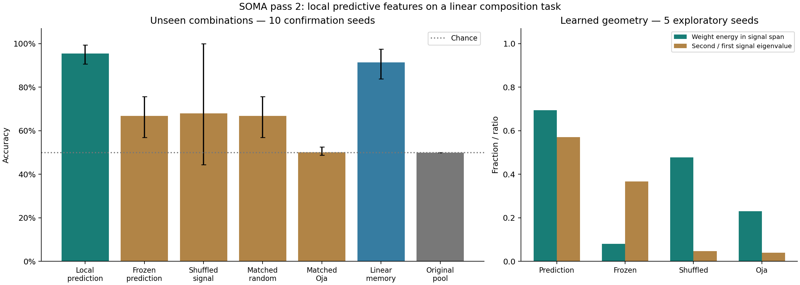

# SOMA pass 2 — 2026-10-11

Hidden synapses now learn useful features by predicting sensory activity,
without receiving outcome labels. On a preregistered linear factor task, the
frozen candidate reached **95.5% on combinations absent from every learning
experience**, across ten confirmation seeds. All registered required-control
gates passed. A stronger linear-memory baseline reached 91.3%, so this result
does not establish a need for hierarchy or deep hidden credit assignment.

The other important finding corrects the previous report: seed 11's apparent
retention failure began as an acquisition failure, before the context switch.
This pass builds on the reviewed fresh-start tip `7139c10`; `VISION.md`, the
original organism, its defaults, and previous raw results remain unchanged.

## Earlier results (pass 1, still valid)

The pass-1 substrate `brain/organism.py` and its records are unchanged. Its
confirmed results, all on small finite tasks with controls (details in
`NOTEBOOK.md` and `experiments/report/SUMMARY.md`):

| Experiment | Result |
|---|---|
| Single-cue delayed recall | 100% through 64 blank steps |
| Two-symbol temporal grammar, gap 8 | 100% with local afferent variance normalization; about 50% without it |
| Lifetime A → reversed B → A, gap 2 | 100% new, 100% old return; 82.4% without pruning protection |
| Same lifetime, gap 8 | 98.0% old return vs 78.2% without protection; seed 11 is an acquisition failure (see A below) |
| Fresh grammar, gap 16 | about 50%: unsolved |
| Sleep-labelled replay | no benefit over equal wake replay |

There are now two separate substrates, `organism.py` (temporal, competitive,
growing) and `predictive.py` (local next-input prediction). Merging what each
has earned into one brain is open work.

## A: diagnose the old return failure

The exact original lifetimes for seeds 10/11/12 were replayed without retuning.
All three final states matched their saved checkpoints completely, including
RNG, synapses and neuronal state. A focused seed-11 replay recorded boundary
connections and actual query winners.

Seed 11 learned original context A at only **73.5% in its final 400 trials**.
It then learned B at 100%, returned to A at 80% in the first 50 and 75% in the
final 400. The other nine confirmation seeds had originally learned A at 100%.
Cell 16 already served both `(0,1)` and `(1,1)` during original learning,
although their outcomes are opposite. Every first-50 return error selected
that same surviving cell. Its seven sensory and two prediction connections
survived B with exactly unchanged strengths.

The cause is representation aliasing, rather than a lost cell or erased output
weights. Weak early-symbol afferents averaged together, and the representation
mismatch did not demand another cell. The earlier 98% mean return score remains
unchanged, but it mixes reliable retention with a mapping that was never
reliably acquired. Future retention studies must require acquisition first.

Fully disabling learning also freezes variance adaptation, suppressing old
winners even in passing brains after a context switch. Such frozen boundary
probes alone cannot establish pruning damage; the uninterrupted trajectories
and surviving connections supply the evidence.

## B: local prediction and held-out combinations

Two four-valued factors generate a sum along two seeded sensory directions,
with independent nuisance in the orthogonal complement. The brain sees raw
sensory coordinates, never factor identities, values, directions or the task
rule. Three noisy views precede a query. The outcome is the sign of the sum of
the factors; each contributes an additive learnable part.

Learning contains 600 episodes from twelve combinations. All factor values
occur, but four combinations are absent even from unlabelled experience.
Evaluation contains 160 episodes over those four combinations, with **no outcome
feedback**. Intrinsic learning continues. Additional independent checkpoint
probes freeze hidden weights, axon statistics and structure during each probe,
so they test transfer without test-time representation adaptation.

### The rule

[brain/predictive.py](brain/predictive.py) implements paired observation and
prediction populations. An observation neuron has fixed random sensory
synapses. Its predictor forecasts that observation activity from the previous
sensory state. After the observation arrives, the receiving predictor's own
error updates its own basal synapses using their source traces and a scalar
gate. No other neuron's error or outcome label enters this update. Outcome
neurons learn separately through their own local errors.

Several predictors are active together. Local axon mean/variance normalization
controls activity scale for every new-module variant. The selected setting
uses eight learned predictors and eight observation counterparts, 424 weighted
connections, and unchanged growth/pruning costs and rates. There is no size
cap; no structural event occurred in the confirmed composition lifetimes.
The controls receive exactly the candidate's structural schedule throughout
learning and primary testing. Stream and schedule hashes verify pairing.

One configuration, [SELECTED_PREDICTIVE.json](experiments/SELECTED_PREDICTIVE.json),
was frozen before seeds 10–19 and reused unchanged for the uncertainty study.
It is an experimental hypothesis, not a replacement for every older brain.

### Confirmation

Means and observed ranges across ten seeds; ranges are not confidence intervals.

| Model | Held-out accuracy | Seen-combination probe |
|---|---:|---:|
| Local prediction | **95.50% [90.63–99.38]** | 93.92% |
| Predictive synapses frozen | 66.81% | 75.75% |
| Prediction signal shuffled | 67.94% | 73.67% |
| Matched random capacity | 66.81% | 75.75% |
| Matched capacity, Oja learning | 50.13% | 66.75% |
| Original selected competitive pool | 50.00% | 66.67% |
| Linear-memory baseline, experiment only | 91.31% | 96.58% |
| Chance / majority / unknown exact template | 50.00% | — |

All ten candidate seeds exceeded 90% on held-out combinations. The original
four-probe checkpoint metric averaged 90%, versus 75% frozen, 65% shuffled,
and 50% Oja/original pool. Supplementary 160-probe frozen-hidden evaluation
averaged **95.31%**, versus 67.75% frozen random features. These supplementary
probes did not replace or relax the original gate.

The initially redundant frozen/matched controls are retained, and the Oja
control adds matched trainable capacity without predictive error. Shuffling
preserves a mean predictable direction: seed 15's shuffled control even scored
100%. The alignment benefit is an ensemble result, not a necessity in every
individual run. The linear baseline also ties the candidate's four-probe mean.

Exploratory geometry helps explain the result. Learned basal weights placed
69.4% of sensory weight energy in the true two-dimensional signal span, versus
8.1% frozen. Shuffling retained 47.8% signal energy but nearly collapsed its
independent directions: second/first signal eigenvalue ratio .047, versus .571
for prediction. This diagnostic used evaluator knowledge only and never taught
or answered for the brain. It supports denoising and preservation of independent
signals, not discovered named factors or an emergent hierarchy.

### Failures and limits

Initial unnormalized predictors scored 80.9% held out; smaller steps alone
scored 82.8% and 85.4%. Those gates remain failed. Frozen features initially
had smaller activity, confounding readout learning; local axon normalization
was preregistered and applied to all variants before selecting the candidate.
The faster .05 homeostatic setting failed the original initial-probe advantage
gate. It was not selected after looking at confirmation.

The task is linear in its clean sensory factors. With parameters/statistics
fixed, the prediction/readout map is affine; a supervised linear-memory model
already solves much of it. The result establishes useful self-supervised hidden
learning and transfer on this task. It does not establish nonlinear composition,
deep outcome credit assignment, language, or a hierarchy of meaning. There
are no new claims of long-range retention or sleep in this architecture.

## C: unlabelled uncertainty probes

Five exploratory learned brains were cloned per condition and received 200
probe episodes each, with no outcome labels. Hidden learning and structure
continued. AUC was measured within each seed and condition, preventing a simple
between-distribution shift from masquerading as error prediction.

| Condition | Accuracy | Mean confidence | View-error AUC | Output-entropy AUC |
|---|---:|---:|---:|---:|
| Familiar combinations | 94.9% | 88.7% | .556 | .954 |
| Held-out combinations | 95.4% | 92.2% | .513 | .941 |
| Nuisance doubled | 86.9% | 88.1% | .505 | .887 |
| Nuisance quadrupled | 79.5% | 87.3% | .487 | .761 |
| Signal reduced | 83.2% | 86.5% | .497 | .813 |
| Same inputs, reversed evaluator labels | 5.1% | 88.7% | .444 | .046 |

Hidden sensory-prediction residuals are poor predictors of classification
errors. Output entropy ranks errors much better under the original outcome
rule, but confidence is miscalibrated under shift. Reversed-label probes have
exactly identical probabilities and brain summaries to familiar probes on
all five seeds: no unlabelled input signal identifies the hidden rule change.
Feedback would be needed to discover it.

There is no learned unknown response, abstention rule, or self-knowledge claim.
The useful precursor is outcome uncertainty, not raw input-prediction error.
Two small seed-0 checkpoints preserve the learned state and the state after
quadrupled nuisance for later diagnosis; that probe was reproduced exactly.

## Verification and records

**32 behavioral tests pass**, including hidden-label isolation over a lifetime,
independence from distant errors, eligibility timing, local homeostasis,
checkpoint continuation with shuffling/growth, pruning integrity, structural
yoking, and AUC tie/missing-class handling. The twelve representative legacy
runs still reproduce exactly in the current reference.

Five pass-2 cases reproduce exactly with their pinned source revisions,
including the confirmation candidate. Exact early replay needs its source
revision: adding the Oja rule regrouped floating-point multiplication in the
new kernel, changing tiny numerical values, and later structural yoking
intentionally changed the exploratory Oja test's population from nine to eight.
The earlier claim of zero test events did not hold for that Oja control; this
was corrected before confirmation. Latest-code replay alone matches only two
of the five sampled early/current cases. Neither failure is hidden or counted
as an exact current-code reproduction. The versioned verifier preserves the
original data and checks the actual recorded source.

The scientific runtime is CPython 3.12.14. PyPy changed numerical state and was
rejected. Initial source hashes captured at completion cannot prove the exact
loaded runner snapshot; confirmation captures hashes at import and its source
was frozen until every trial finished. These provenance limits are recorded.

- [NOTEBOOK.md](NOTEBOOK.md): every attempted condition and correction.
- [PROTOCOL.md](experiments/PROTOCOL.md): preregistered gates and follow-ups.
- [PASS2.md](experiments/report/PASS2.md): ranges, every gate, uncertainty results and raw-file hashes.
- [Experiment instructions](experiments/README.md): reproduce the studies.
- [Versioned replay verifier](experiments/check_pass2_reproducibility.py): exact source-specific receipts.
- [Original reproducibility receipts](experiments/report/REPRODUCIBILITY.json): twelve unchanged legacy checks.

Raw files include exploratory failures, diagnostic repeats and a rejected
runtime; their record count is not a count of independent successful studies.
Generated machine summaries and SVGs are excluded from commits. Previous
results and the vision were not edited.

## Next

1. Preregister a nonlinearly separable factor task, with unseen combinations and
   a strong linear baseline. Add generic nonlinear dendritic prediction or
   interacting learned populations; require every component to beat frozen,
   shuffled and matched-capacity controls before claiming hierarchy.
2. Include predictable nuisance and different outcome functions, so successful
   sensory prediction cannot be assumed to represent task-relevant information.
3. Revisit temporal/contextual lifetimes with explicit initial acquisition gates.
   The new one-step predictor has not replaced the older temporal mechanisms.
4. Learn outcome reliability from local outcome evidence, then test calibration
   under shift. Raw sensory surprise alone is insufficient. Keep unknown actions
   learned, rather than imposed by a threshold.

Real text and endogenous sleep remain later research. This pass earns a local
predictive primitive and a better diagnosis, while the central deep problems
remain open.
