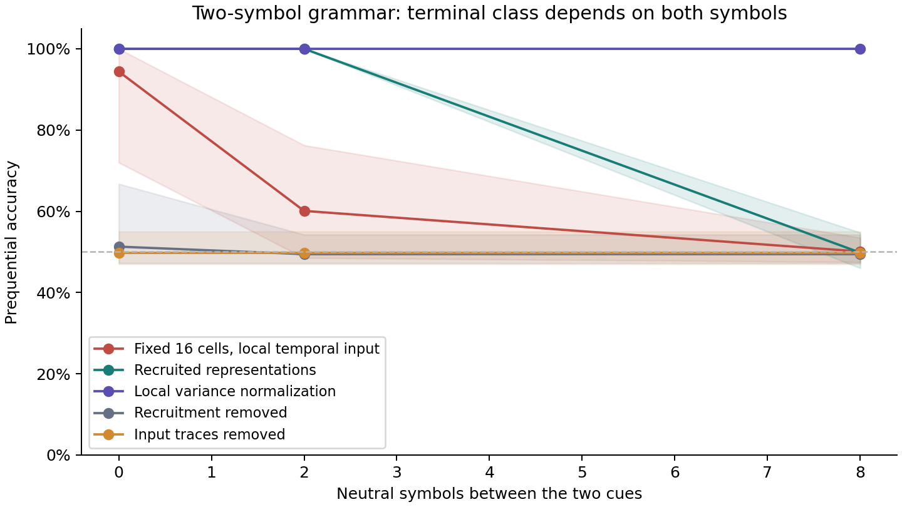

# SOMA research pass — 2026-10-10

SOMA now has an inspectable, standard-library neural substrate and controlled
experiments on temporal memory, self-recruited representations, and continual
learning. This is a foundation for researching the vision, not a conversational
brain or a demonstration of general intelligence.

The work starts from the fresh-start branch `claude/youthful-ritchie-vq1bog`,
commit `524a0b2abc8d5e2af97931fcd5354c10b12d9a06`, rather than the obsolete
research on `main`. Local branch: `codex/soma-local-learning-2026-10-10`.

## What the measurements support

All task scores are prequential: predict first, then receive the outcome and
continue learning. Seeds 0–4 were exploratory; frozen selections precede
confirmation streams 10–19. These are new streams of small finite tasks, not
held-out concepts or language generalization. Means below are across seeds.

| Experiment | Result | What the control establishes |
|---|---|---|
| Single-cue delayed recall | 100% through 64 blank steps in confirmation | Temporal mechanisms earn their place; a linear readout also solves this task, so it does not establish hidden representation learning. |
| Two-symbol temporal grammar, gap 8 | 100% on ten confirmation seeds | Normalization-off is 49.825%; recruitment-off and frozen scale statistics also fail. Gaps 0/2 remain 100%. |
| One lifetime: context A → reversed B → A, gap 2 | New context and first-50 old return both 100% on ten seeds | Removing pruning protection reduces old return to 82.4%. |
| Same lifetime, gap 8, combined mechanisms | New context 100%; old return 98.0%, range 80–100%, ten seeds | Removing protection: new context 100%, old return 78.2%, range 64–90%. Nine candidate seeds meet the 90% return threshold; seed 11 fails. |
| Fresh grammar at gap 16 | About 50.1% in exploration | The longer temporal problem remains unsolved from this starting history. |
| Unlabelled probes after a learned gap-8 lifetime | Gap 16: 95.5%; gaps 32/64: 51.5%/51.0%, five checkpoint seeds | Developmental history changes transfer; no outcome feedback was supplied during these probes. This does not overturn the fresh gap-16 failure. |
| Matched external replay | Sleep-labelled replay equals wake-labelled replay | No distinct sleep benefit or endogenous replay has been established. |

In the gap-8 lifetime, every candidate's first old-context response was correct;
the first-50 window then includes further learning. The 98% figure must not be
presented as frozen retention. Seed 11's 80% result remains a failed individual
return gate, despite the passing mean. No configuration was retuned afterward.

## What was built

[brain/organism.py](brain/organism.py) contains neurons, synapses, local traces,
plasticity/evidence, growth, pruning, and atomic save/resume including RNG state.
Knowledge resides in neural state. There is no backpropagation, pretrained
language model, count-table brain, or task-specific decoder inside SOMA.
Outcome synapses use their receiving neuron's own error; hidden afferents never
receive the target. A scalar global signal gates update magnitude.

The most useful additions were event-preserving traces, competitive
representations, recruitment on unlabelled experience, and local afferent
variance normalization. Without normalization, a weak older signal survives
but scarcely affects matching. An explicitly labelled oracle diagnostic could
decode those traces; it never answered for or taught the brain. Normalization
made the older signal matter and enabled the gap-8 grammar. It also increased
the recruited population, so improved resolution and additional capacity are
not separated by these experiments.

Consolidated synapses carry local evidence that protects them from pruning.
Active prefix representations survive missing outcome connections, and useful
prediction connections can regrow. The combined lifetime ends with a mean of
39.8 hidden cells, starting from one. Growth has costs and rates, no fixed
population cap. Random labels exposed an earlier failure: prediction-error
growth caused 150 births per seed without improving chance accuracy. The
matched representation-novelty rule recruited far fewer cells.

## Records and verification

The raw record contains **1,537 run records: 1,534 complete and three incomplete**
wall-budget-stopped lifetimes, across 39 JSONL files. This includes controls,
exploration, confirmation, and diagnostic runs; it is not 1,534 independent
successful experiments. An additional aborted recruitment attempt is recorded
separately, including its partial diagnostic. All failures are retained.

Twenty behavioral tests pass, covering target isolation, unlabelled growth,
pruning integrity, checkpoint continuation, local scale statistics, and atomic
checkpoint replacement. Twelve representative historic runs were reproduced
exactly for recorded scores, phase metrics, and brain counters. This sample
check is not a rerun of the entire study.

- [NOTEBOOK.md](NOTEBOOK.md): questions, methods, results, and failures.
- [experiments/PROTOCOL.md](experiments/PROTOCOL.md): registered gates and follow-ups.
- [experiments/report/SUMMARY.md](experiments/report/SUMMARY.md): all configurations and observed ranges.
- [experiments/report/SUMMARY.json](experiments/report/SUMMARY.json): machine-readable summaries and raw-file hashes.
- [experiments/report/REPRODUCIBILITY.json](experiments/report/REPRODUCIBILITY.json): exact-match receipts.
- [experiments/checkpoints](experiments/checkpoints): completed lifetime states.



## What remains missing

The substrate currently has one competitive representation pool and a local
outcome readout. It has not discovered a hierarchy of meaning or demonstrated
deep hidden credit assignment. Freezing hidden afferent weights often preserves
short-task success; recruitment and scale adaptation do much of the work.
Finite repeated symbol combinations are much easier than language.

Replay uses external experiment scaffolding, not internally generated sleep.
Confidence decreases on unfamiliar contexts, but unsupported long gaps still
produce roughly 66% confidence at chance accuracy. There is no learned
self-knowledge or unknown-response policy. The single failed combined-lifetime
seed also shows that consolidation is not robust across all tested histories.

## Next research steps

1. Diagnose seed 11 using its saved state: distinguish lost representations,
   damaged prediction edges, and interference. Compare matched-capacity controls
   before attributing normalization's gain solely to its scale rule.
2. Add local prediction between hidden populations. Start with a task requiring
   composition across unfamiliar combinations; compare one pool, two interacting
   populations, frozen hidden learning, and shuffled hidden predictions. Require
   improvement before claiming hierarchy or hidden credit assignment.
3. Test developmental curricula against matched-exposure direct learning across
   longer delays. The unlabelled gap-16 transfer makes this a useful experiment,
   but not yet a proven general principle.
4. Generate replay from saved neural activity rather than external example
   storage, with equal-update wake controls and old/new retention measurements.
5. Test whether local evidence predicts errors under controlled distribution
   changes before attempting a learned uncertainty response.

Real text should follow earned progress on these mechanisms. Scaling the
current finite-template pool would not resolve the central open problems.

## Reproduce and restore

The core and experiments use Python's standard library; figures additionally
need Matplotlib. Start with:

```sh
python -B -m unittest experiments.test_brain -v
python -B -m experiments.run --help
python -B -m experiments.report
```

Use the frozen `SELECTED_*.json` files with the reproduction wrapper; it refuses
to overwrite prior results. Exact invocation details are in
[experiments/README.md](experiments/README.md).

GitHub rejected both Git push and connector branch creation with HTTP 403.
There is no published branch or pull request. The work is committed locally;
a standalone ZIP, incremental Git bundle, and binary patch are supplied as
portable backups. See [RESTORE.md](RESTORE.md).
