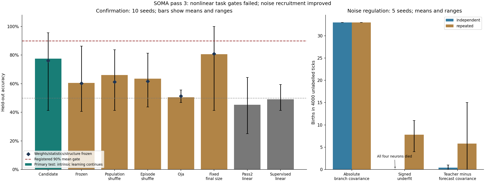
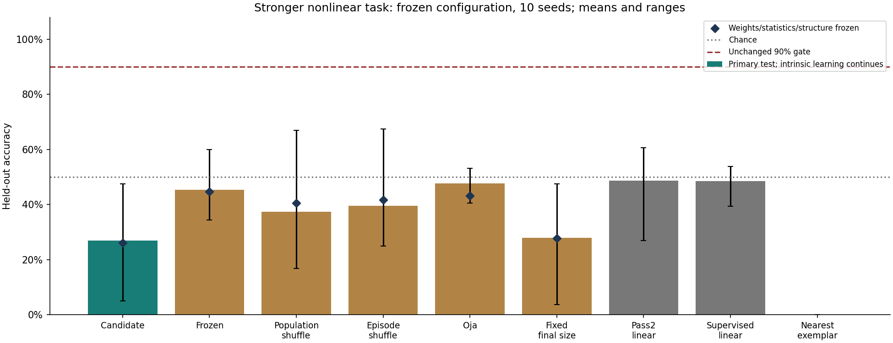

# SOMA current research state — 2026-10-11

**Pass 3 did not establish learned nonlinear composition or a reliable unified
brain.** It built and measured a single experimental substrate, exposed a
noise-driven growth failure, improved recruitment regulation, and produced a
stronger benchmark that the frozen candidate fails. The earlier pass-1 and
pass-2 measured results remain valid and are retained below.

The sharpest result is the additional nonlinear falsification: **26.9% on
withheld combinations**, against **45.3% frozen nonlinear features** and
**48.5% supervised linear**. Prediction learning can worsen the representation
used for transfer. This failure is more informative than the first task's
77.6% because the first task also admits a perfect nearest-example shortcut.

This pass starts from the reviewed `6f92673`. `VISION.md`, `organism.py`,
`predictive.py`, old defaults/selections and every previous raw record remain
unchanged. No task rule or factor identity was added to `brain/`.

## Pass 3 A: one substrate with nonlinear local prediction

[brain/soma.py](brain/soma.py) contains sensory event traces, source-variance
normalization, neurons with generic saturating dendrites, local future
prediction, outcome synapses, growth and predictive-evidence pruning. It
instantiates one population directly; it does not choose a specialist by task.

Each neuron has four initially random tanh branches and a sensory observation
dendrite. Fixed excitatory/inhibitory branch polarities combine activity at
the soma. An arriving observation teaches the PREVIOUS forecast: a synapse
changes from its own stored source eligibility, its own soma's error, its
branch polarity and unsaturated-activity gate, plus a scalar learning amount.
There is no differentiation through other neurons or transport of learned
outcome weights. Only outcome neurons receive labels. All predictive
observation projections remain fixed in this hypothesis.

The selected architecture begins with four neurons. It has no size cap.
It preserves exact state/RNG save/resume and removes every connection when
a neuron dies. Soma counts one complete neuron with all dendrites; the old
predictive module counts paired populations differently. Weighted synapse
counts exclude fixed branch-to-soma polarities. [brain/README.md](brain/README.md)
states each rule's local information and these counting conventions.

### Three hypotheses, all failures retained

| Exploratory hypothesis, seeds 0–4 | Held out | Fully frozen probe | Independent-noise births | Repeated-input births |
|---|---:|---:|---:|---:|
| Absolute residual/branch covariance | 99.13% | 87.38% | 33.0 | 33.0 |
| Signed error/own-forecast underfit | 61.88% | 56.00% | 0.0 | 7.8 |
| Observation covariance minus forecast covariance | 75.13% | 79.50% | 0.4 | 5.8 |

Noise probes last 4000 unlabelled ticks, five seeds. These are finite-duration
observations, not proof of asymptotic size stability. The first rule recruits
at every opportunity on noise: its negative self-prediction covariance is
mistaken for missing structure. The signed rule suppresses that expansion,
but aggressive pruning and a missing growth signal extinguish two task brains
and every independent-noise brain. Those extinct runs are not successes.
Its fixed-size comparison needs a one-neuron fallback in the two zero-size
case lifetimes, an explicit capacity limitation.

The third rule compares each branch's centered sensory/activity covariance
with its own forecast/activity covariance, using only the positive unexplained
part as structural pressure. Predictive evidence and pruning threshold scale
together. It reduces noise recruitment, but exposes inadequate nonlinear
capacity. [SELECTED_SOMA.json](experiments/SELECTED_SOMA.json) freezes this
**blocked diagnostic hypothesis**, not a passing default. No further model
tuning occurred.

### First nonlinear task: registered confirmation fails

Two four-valued factors emit raw randomly oriented sensory coordinates plus
orthogonal nuisance. The outcome depends on their product. Four combinations
are absent from all learning experience; each factor value appears elsewhere.
A product-bearing future view arrives AFTER the query. It teaches prediction
on the next tick, never supplies the current query answer.

Training has 1200 episodes; testing has 160 balanced withheld episodes with
no outcome labels. Input-driven learning continues. A separate checkpoint
probe fixes weights, normalization statistics and structure, while ordinary
sensory traces evolve. Its score distinguishes acquired transfer from
adaptation to future views that reveal interaction structure after a query.

Means across ten frozen confirmation seeds, 10–19:

| Model | Held out | Frozen weights/statistics/structure probe |
|---|---:|---:|
| Selected nonlinear predictor | **77.56%** | **76.06%** |
| Hidden synapses frozen at birth | 60.50% | 60.31% |
| Observation signal shuffled across neurons | 66.00% | 61.25% |
| Observation teachers shuffled across episodes | 63.44% | 61.63% |
| Matched capacity, Oja branch learning | 50.44% | 51.38% |
| Predictive learning, fixed at candidate final size | **80.56%** | 80.94% |
| Pass-2 selected linear predictor | 45.25% | — |
| Supervised linear memory, experiment only | 49.13% | — |
| Chance / majority | 50.00% | — |

All 80 runs complete; candidate range 41.25–95.63%, seen probe 84.5%.
All original gates remain unchanged. Mean accuracy, seen accuracy, individual
reliability, frozen-transfer threshold, fixed-size advantage and the living
structure gate FAIL. Other required-control mean advantages and all pairing
checks pass. Births average 5, deaths 1.7, final size 7.3; only **5/10**
lifetimes contain both births and deaths, below the registered 9/10.
Frozen/shuffled/Oja controls replay the candidate's exact structural schedule
and wiring initialization throughout train/test. The fixed-final-size control
starts larger and gets full exposure; its success prevents a growth-benefit
claim. No candidate structural event is forced by an experimental schedule.

The first task excludes exact lookup entries, but **nearest raw examples score
100% on every withheld and seen stream**. Its geometry therefore does not
exclude similarity-based memorization. This was measured as an explicitly
experiment-only baseline after noticing the inadequate construction; it never
teaches or answers for SOMA, and it did not change a gate.

In the matched predictable-nuisance condition, the future view contains
x²+y² instead of the outcome-relevant interaction. Candidate 61.13%, frozen
60.25% on seeds 0–4, compared with 75.13%/56% in the matching interaction
condition. Predicting something well need not create task-useful features.

### Stronger frozen-config falsification

To repair the nearest-template flaw, an additional preregistered condition
uses q(v)=v(v²−5)/6. Its signs alternate across the four raw factor values.
The future sensory view contains q(x)q(y), after the query, and the outcome
is its sign. Adjacent seen examples now have the opposite answer. Factor
values, sensory axes, nuisance, withheld pairs and episode counts are retained.
The population affine-logistic optimum is chance in both tasks: classes have
equal mass and zero raw class means. Actual linear controls are measured too.

This tests the **already frozen model**. No configuration or original gate
changes. Seeds 0–4 are measurements, then 10–19 are a fixed-model falsification;
these seed/direction identities had already been used in the first benchmark.
They are not independent new evidence for a newly tuned hypothesis.
All 45 exploratory and 90 later runs complete.

| Model, ten later seeds | Held out | Seen | Frozen probe |
|---|---:|---:|---:|
| Selected nonlinear predictor | **26.88%** | 60.83% | 26.06% |
| Frozen nonlinear features | **45.31%** | 54.50% | 44.75% |
| Population shuffle | 37.38% | 58.08% | 40.50% |
| Episode shuffle | 39.56% | 55.33% | 41.75% |
| Oja capacity control | 47.69% | 49.67% | 43.13% |
| Fixed-final-size predictor | 27.88% | 60.83% | 27.81% |
| Pass-2 linear predictor | 48.69% | 51.08% | — |
| Supervised linear memory | 48.50% | 50.58% | — |
| Nearest raw exemplar | **0.00%** | **100.00%** | — |

Candidate range 5–47.5%. Every accuracy, transfer and control-advantage gate
FAILS; the anti-nearest construction and pairing checks pass. Mean births 4,
deaths 1.6; again only 5/10 have both. Its weak seen score shows an acquisition
problem too, not just loss of a mapping already reliably acquired.

The model learns an attractive wrong extrapolation rather than robust factor
composition. A low-order proxy sign(xy) answers two-thirds of the seen pairs
but NONE of the withheld pairs in this condition, consistent with the error
pattern; this does not identify the actual learned neuronal function. Under
factorization, withheld product M[i,j] is determined by three seen relations:
M[i,0]M[1,j]/M[1,0]. This is an environment identity, never a solver or a
training signal supplied to the brain.

The nearest-exemplar baseline's fixed 99% probability is an interface convention;
only its accuracy is interpreted, not calibration or arbitrary log loss.

## Pass 3 B: one configuration across the specialists' interfaces

Only input/output counts and seed change. Every other selected parameter is
shared. Five independent lifetimes per task, seeds 0–4; this is a compatibility
measurement, not a second tuned selection.

| Task | Shared Soma | Specialist, same five streams |
|---|---:|---:|
| First nonlinear composition task | 75.13% | Pass-2 linear control 55.00% |
| Original linear composition task | 75.00% | 97.00% |
| Original temporal grammar, gap 8 | 65.80% | 100.00% |
| Contextual lifetime, initial-A acquisition | **56.00%; 0/5 pass** | **94.30%; 4/5 pass** |
| Contextual lifetime, new-B final 400 | 59.35% | 100.00% |
| First50 old-context return, raw | 43.20% | 99.20% |
| Acquisition-eligible return | **undefined** | **100.00%, four eligible brains** |

Specialist seed 3 acquires initial A at only 71.5%. Its 96% return is not clean
retention evidence. Preserve that case alongside the earlier seed 11 diagnosis.
Every shared candidate fails acquisition, so **none of its returns establishes
retention or forgetting**. Do not disguise its 43.2% as a retention comparison.

Trace-off gap 8 scores 50.1%, versus 65.8% with traces. Temporal state helps on
average but is unreliable. Protection-off returns 46.4% and also fails every
acquisition gate: no retention benefit is established. These are diagnostic
ablations, not per-task retuning. The new predictive-evidence protection is
not numerically the old organism's afferent/pruning safeguards.

The substrate starts unification of principles, but has not inherited the
specialists' reliability. Observation projections are still fixed; growth
adds new random observation targets rather than repairing the dendrites of
the neuron whose predictive function is insufficient.

## Pass 3 C: longer time

Only the longer-time direction was chosen after A/B measurements completed.
The same shared configuration scores **50.3% at fresh gap 16**, trace-off 50.2%,
five seeds each. All runs complete. Gap 16 remains unsolved; no replay/sleep
mechanism or benefit is claimed.

## Verification and records

**46 tests pass**: local hidden/branch learning ignores outcomes and distant
errors, event eligibility/homeostasis, growth/pruning integrity, exact
checkpoint continuation, observation replacement controls, covariance pressure,
future-view isolation, and both task constructions. The stricter task test
verifies nearest memorization fails and classes retain equal raw means.

**12 representative pass-3 replays match exactly**: three exploratory
hypotheses, four selected confirmation variants with living structure,
three shared tasks, and two stronger-task cases. Comparisons include individual
probabilities, trajectories, structural schedules and contextual phases.
The first harness receipt fails because Python tuples were compared to JSON
lists; its source snapshot and failure remain intact. The corrected verifier
compares exact JSON representations, with **no numerical tolerance**; a test
checks that 1e-12 drift still fails.

All twelve legacy current-code checks pass again. Pass-2 pinned-source checks
remain 5/5 exact; current-code 2/5, the same documented early-version limitation
as before. Scientific runtime: CPython 3.12.14. Source hashes captured at import,
core source frozen throughout every batch. One 96 KB seed 13 pre-test state is
saved for later dendritic diagnosis. The two old kernels, selections, vision
and pre-pass3 raw files match base bytes.

- [PASS3.md](experiments/report/PASS3.md): every seed range, gate, acquisition guard, replay receipt and raw-file hash.
- [PROTOCOL.md](experiments/PROTOCOL.md): preregistration and falsification scope.
- [NOTEBOOK.md](NOTEBOOK.md): every failure, correction and interpretation.
- [Experiment instructions](experiments/README.md): exact study/replay commands.

Copies, baselines and replay receipts are not additional independent successful
studies. Generated JSON summaries/SVGs and delivery notes are excluded.

## Next research

1. Recruit generic branches/connections at the receiving neuron whose
   predictive function is inadequate, instead of only creating a new random
   observation target. Require a benefit over fixed-final-size capacity and
   matched updates, plus noise suppression and genuine pruning.
2. Use the stronger benchmark to test factor-level nonlinear representations
   and their interactions. Grow complexity where local residual evidence
   demands it. Keep frozen/random/episode-shuffled controls and strong
   nearest-template baselines; do not infer hierarchy from a high easy-task score.
3. Diagnose and fix seen-task acquisition before claiming generalization or
   retention. Retain the same shared configuration across interfaces and
   measure its losses to specialists. Preserve rare useful temporal pathways
   with genuinely local evidence, rather than assuming prediction usefulness
   is the same as outcome usefulness.

Real text, learned self-knowledge and endogenous sleep remain later research.
The synthetic-brain vision is unchanged; the new measurements identify what
the current local rules are still missing.

## Earlier results (pass 2, still valid)

`brain/predictive.py`: predictor neurons learn from their own next-input
prediction error, without labels. Details: `experiments/report/PASS2.md` and
the pass-2 entries in `NOTEBOOK.md`.

| Experiment | Result |
|---|---|
| Linear factor task, unseen combinations, ten confirmation seeds | 95.5% local prediction; 66.8% frozen; 67.9% shuffled; 50.1% Oja; 91.3% supervised linear baseline |
| Seed-11 diagnosis (pass-1 lifetime) | acquisition failure by representation aliasing, not forgetting |
| Unlabelled uncertainty probes | output entropy ranks errors (AUC about .95 familiar), hidden prediction error does not (about .5); overconfident under shift |

The task is linear, so this shows self-supervised denoising, not nonlinear
composition.

## Earlier results (pass 1, still valid)

The pass-1 substrate `brain/organism.py` and its records are unchanged. Its
confirmed results, all on small finite tasks with controls (details in
`NOTEBOOK.md` and `experiments/report/SUMMARY.md`):

| Experiment | Result |
|---|---|
| Single-cue delayed recall | 100% through 64 blank steps |
| Two-symbol temporal grammar, gap 8 | 100% with local afferent variance normalization; about 50% without it |
| Lifetime A → reversed B → A, gap 2 | 100% new, 100% old return; 82.4% without pruning protection |
| Same lifetime, gap 8 | 98.0% old return vs 78.2% without protection; seed 11 is an acquisition failure (see pass 2) |
| Fresh grammar, gap 16 | about 50%: unsolved |
| Sleep-labelled replay | no benefit over equal wake replay |

There are now three substrates: `organism.py` (pass 1), `predictive.py`
(pass 2), and `soma.py` (pass 3, the first attempt at one brain).
